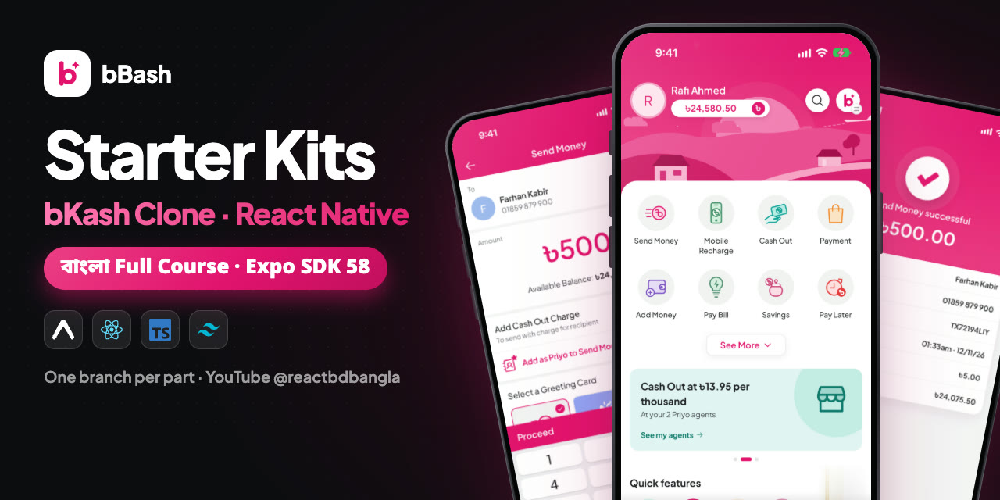
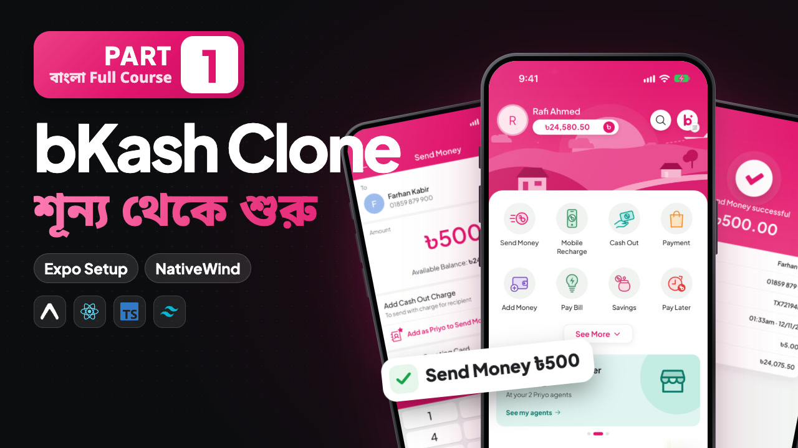
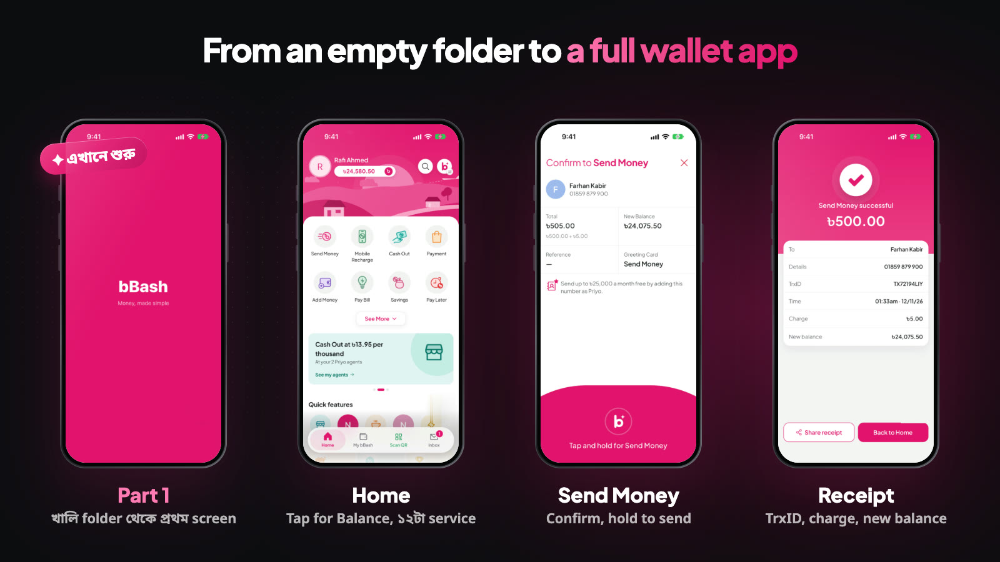

<p align="center">
  <a href="https://youtube.com/playlist?list=PLe17jIbpkmaA&si=_tlu2p2u4_wcU0w5">
    
  </a>
</p>

<h1 align="center">bBash Starter Kits</h1>

<p align="center">
  <b>Build a bKash-style mobile wallet app with React Native and Expo, step by step, in Bangla.</b><br />
  বাংলায় React Native আর Expo দিয়ে bKash-এর মত একটা mobile wallet app, একদম খালি folder থেকে।
</p>

<p align="center">
  <a href="https://youtube.com/playlist?list=PLe17jIbpkmaA&si=_tlu2p2u4_wcU0w5"></a>
  
  
  
  
  
  <a href="https://buymeacoffee.com/reactbd"></a>
</p>

<p align="center">
  <a href="https://youtube.com/playlist?list=PLe17jIbpkmaA&si=_tlu2p2u4_wcU0w5"><b>▶ Watch the course</b></a> ·
  <a href="https://www.youtube.com/watch?v=bKl-W8o-OAk"><b>🎬 Trailer</b></a> ·
  <a href="https://reactbd.com"><b>🌐 reactbd.com</b></a> ·
  <a href="https://buymeacoffee.com/reactbd"><b>☕ Buy me a coffee</b></a>
</p>

---

## 📺 Watch the course

<a href="https://youtube.com/playlist?list=PLe17jIbpkmaA&si=_tlu2p2u4_wcU0w5"></a>

**bKash Clone App: React Native বাংলা Full Course (Expo)** is a 20-part YouTube course on [@reactbdbangla](https://www.youtube.com/@reactbdbangla). Every file and every line is typed and explained on screen, in Bangla.

এই repo course-এর সঙ্গী: প্রতিটা part-এর শেষে code যেমন থাকে, ঠিক তেমন একটা করে branch। Video দেখতে দেখতে আটকে গেলে, বা মাঝখান থেকে শুরু করতে চাইলে, ওই part-এর branch নিয়ে নিন।

- ▶ **Playlist:** https://youtube.com/playlist?list=PLe17jIbpkmaA&si=_tlu2p2u4_wcU0w5
- 🎬 **Trailer, what we're building:** https://www.youtube.com/watch?v=bKl-W8o-OAk
- 🌐 **More from me:** https://reactbd.com

<br clear="right" />

## ✨ What you'll build

<p align="center"></p>

bBash is a learning clone of a mobile wallet: frontend first, on dummy data. A second playlist connects a real backend.

- **Send Money, Cash Out, Mobile Recharge, Pay Bill**: ১২টা service, একটাই flow
- **PIN, hold-to-confirm, receipt** আর **Inbox**
- **OTP, KYC, Face ID, QR scan, Split Bill, Savings, Rewards, Pay Later, Priyo number**
- **বাংলা আর English**: পুরো app দুই ভাষায়

## 🌿 Branches: one per part

`main` always has the latest part. Each part also has its own branch, frozen at the end of that video.

| Branch                                                                     | Part                                        | What's inside                                                                                                                                                                                                    |
| -------------------------------------------------------------------------- | ------------------------------------------- | ---------------------------------------------------------------------------------------------------------------------------------------------------------------------------------------------------------------- |
| [`part-01`](https://github.com/noorjsdivs/bbash-starter-kits/tree/part-01) | **Part 1 · খালি folder থেকে প্রথম Expo app** | Expo SDK 58 project (Expo Router, TypeScript), template reset, `app.json` set up as bBash, NativeWind 4 + Tailwind CSS 3, Prettier + Tailwind plugin, ESLint, and the first pink screen written with `className` |

পরের part-গুলো আসার সাথে সাথে এখানে নতুন branch যোগ হবে।

## 🚀 Quick start

**You need / যা লাগবে**

- **Node.js** LTS, from https://nodejs.org/en/download. Check with `node -v`.
- **Git**: `git --version`
- **VS Code** with the **Expo Tools** extension
- একটা জায়গা app চালানোর জন্য: Mac-এ iOS Simulator (Xcode), Windows/Linux-এ Android Studio emulator, browser, অথবা phone-এ **Expo Go** (SDK 58 চালাতে পারে এমন version)

**Run it / চালান**

```bash
git clone https://github.com/noorjsdivs/bbash-starter-kits.git bbash-wallet
cd bbash-wallet
git checkout part-01
npm install
npx expo start
```

In the terminal, press `i` for the iOS Simulator, `a` for an Android emulator or `w` for the browser. On a phone, scan the QR code with Expo Go.

## ✅ Two checks after every part

```bash
npx tsc --noEmit   # TypeScript: no output = no errors
npx expo lint      # ESLint with Expo's rules
```

## 🧩 `className` not working?

NativeWind stands on four files: `tailwind.config.ts`, `src/global.css`, `babel.config.js` and `metro.config.js`. If styles don't show up, check these three:

1. `src/app/_layout.tsx` imports `@/global.css` on its first line
2. `metro.config.js` has the right path in `withNativeWind(config, { input: './src/global.css' })`
3. `babel.config.js` sets `jsxImportSource: 'nativewind'`

Then clear the cache and start again: `npx expo start --clear`

Expo Go বলছে এই SDK চালাতে পারে না? আপাতত simulator বা browser-এ চালান: আপনার code-এ কোন ভুল নেই।

## 📁 Project structure (Part 1)

```text
bbash-wallet/
├── src/
│   ├── app/
│   │   ├── _layout.tsx      # Stack navigator, imports global.css
│   │   └── index.tsx        # the first bBash screen, styled with className
│   └── global.css           # Tailwind base, components, utilities
├── assets/                  # icon, splash, adaptive icon
├── app.json                 # bBash's name, slug, scheme, light mode, brand colour
├── babel.config.js          # jsxImportSource: 'nativewind'
├── metro.config.js          # withNativeWind, input: global.css
├── tailwind.config.ts       # content paths + NativeWind preset
├── nativewind-env.d.ts      # className types and *.css imports
├── eslint.config.js         # eslint-config-expo
├── .prettierrc              # Prettier + prettier-plugin-tailwindcss
└── tsconfig.json            # strict, @/ path aliases
```

## 🛠 Tech stack

|              |                                                                          |
| ------------ | ------------------------------------------------------------------------ |
| Framework    | [Expo](https://expo.dev) SDK 58 · React Native 0.88 · React 19           |
| Language     | TypeScript 6 (strict)                                                    |
| Navigation   | Expo Router (file-based routes in `src/app`)                             |
| Styling      | [NativeWind](https://www.nativewind.dev) 4 · Tailwind CSS 3.4            |
| Code quality | Prettier + `prettier-plugin-tailwindcss` · ESLint (`eslint-config-expo`) |

## ☕ Support

If the course helps you, you can support it here:

<a href="https://buymeacoffee.com/reactbd"></a>

- ⭐ **Star this repo** so others can find it
- 🔔 **Subscribe** to [@reactbdbangla](https://www.youtube.com/@reactbdbangla) and turn on the bell for new parts
- 🌐 **More projects and courses:** [reactbd.com](https://reactbd.com)

## ⚠️ Disclaimer

bBash is a clone built for learning. It is **not** bKash's official app and has no connection to bKash. There is no real money: every name, number and transaction is dummy data.

bBash শেখার জন্য বানানো একটা clone। এটা bKash-এর official app না, আর bKash-এর সাথে এর কোন সম্পর্ক নেই। সব নাম, নম্বর আর লেনদেন dummy data; কোন আসল টাকা নেই।

## 📄 License

[MIT](LICENSE). The licence file comes with the Expo project template.

<p align="center">Made with ❤️ in Bangla by <a href="https://reactbd.com">reactbd.com</a></p>
